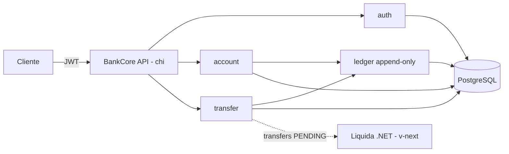
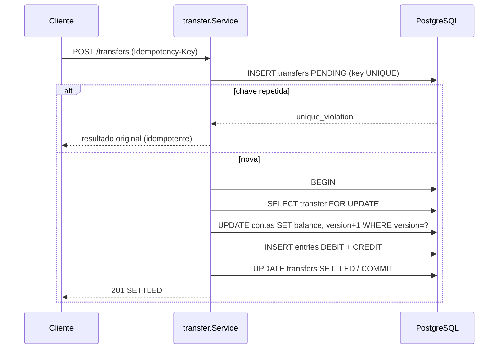

# BankCore

API de **núcleo bancário** em **Go**: contas, depósitos, saques e **transferências atômicas** entre contas, com extrato e **ledger append-only auditável**. Foco em consistência, concorrência e integridade monetária.

> Projeto-vitrine de backend em Go. Companheiro do [Liquida](../Liquida) (.NET + Angular), que **liquida** as transferências originadas aqui. Juntos formam um portfólio poliglota (Go + .NET + Angular) de sistemas bancários.

## Arquitetura (resumo)
- **Transferência atômica** dentro de uma transação de banco (pgx `tx`): débito + crédito + dois lançamentos, ou tudo ou nada.
- **Concorrência** com optimistic locking (coluna `version`) e retry em conflito. Ver ADR 0001.
- **Dinheiro** em centavos (`int64`), nunca `float64`. Ver ADR 0002.
- **Idempotência** de transferências via `Idempotency-Key`. Ver ADR 0003.
- **Ledger append-only**: saldo é projeção com invariante `saldo = soma(lançamentos)`.



Transferência atômica com optimistic lock e idempotência:



## Stack
Go 1.22+ · chi · pgx + PostgreSQL · golang-migrate · JWT · testcontainers-go · Docker · Makefile · GitHub Actions · Swagger (swaggo).

## Documentação (spec-driven)
- **Spec (versionada):** [`v1.0.0`](docs/specs/spec-v1.0.0.md) · [`v1.1.0`](docs/specs/spec-v1.1.0.md) · [`v1.2.0`](docs/specs/spec-v1.2.0.md) · [`v1.3.0`](docs/specs/spec-v1.3.0.md) · [`v1.4.0`](docs/specs/spec-v1.4.0.md)
- **PRD:** [`docs/PRD_BankCore_Go.md`](docs/PRD_BankCore_Go.md)
- **ADRs:** [0001 optimistic locking](docs/adr/0001-optimistic-locking.md) · [0002 dinheiro int64](docs/adr/0002-dinheiro-int64-centavos.md) · [0003 idempotência](docs/adr/0003-idempotencia-transferencias.md) · [0004 fronteira de liquidação](docs/adr/0004-fronteira-liquidacao-liquida.md) · [0005 simulador sem auth](docs/adr/0005-simulador-rotas-demo-sem-auth.md) · [0006 reset da simulação](docs/adr/0006-reset-ambiente-simulacao.md)

## Como rodar
```bash
cp .env.example .env
make compose-up          # sobe o PostgreSQL
make migrate-up          # aplica as migrations (via docker migrate/migrate)
make run                 # sobe a API em :8080
```
Health check: `curl localhost:8080/health`.

## Endpoints
| Método | Rota | Auth |
|---|---|---|
| POST | `/auth/register` | pública |
| POST | `/auth/login` | pública |
| POST | `/auth/token` (client-credentials) | pública |
| POST | `/accounts` | cliente |
| GET | `/accounts/{id}` | dono/admin |
| POST | `/accounts/{id}/deposit` | dono/admin |
| POST | `/accounts/{id}/withdraw` | dono/admin |
| GET | `/accounts/{id}/statement?page=` | dono/admin |
| POST | `/transfers` (header `Idempotency-Key`) | dono/admin |
| GET | `/transfers?status=` | dono |
| GET | `/transfers/{id}` | participante/admin |
| GET | `/settlement/transfers?status=` | settlement |
| PATCH | `/transfers/{id}/settle` | settlement |
| PATCH | `/transfers/{id}/fail` | settlement |
| GET | `/admin/accounts` | admin |
| PATCH | `/admin/accounts/{id}/status` | admin |
| GET | `/admin/transfers?status=` | admin |
| POST | `/admin/service-clients` | admin |
| POST | `/simulation/start` | pública, só com `SIMULATION_ENABLED=true` |
| POST | `/simulation/stop` | pública, só com `SIMULATION_ENABLED=true` |
| POST | `/simulation/reset` | pública, só com `SIMULATION_ENABLED=true` |
| GET | `/simulation/status` | pública, só com `SIMULATION_ENABLED=true` |
| GET | `/simulation/stats` | pública, só com `SIMULATION_ENABLED=true` |
| GET | `/health` | pública |
| GET | `/swagger/index.html` | pública |

Valores monetários entram/saem em decimal (`"100.50"`) e são operados internamente em centavos `int64`.

### Fronteira de liquidação com o Liquida (v1.1.0)
Com `LIQUIDA_INTEGRATION=external`, `POST /transfers` move o dinheiro atomicamente mas deixa a transferência `PENDING`; o Liquida autentica via client-credentials (`POST /auth/token` → JWT `SETTLEMENT` com TTL curto), lê o backlog em `GET /settlement/transfers?status=PENDING` (role SETTLEMENT, least-privilege, paginação offset `page`/`page_size` 50 + `has_next`) e confirma com `PATCH /transfers/{id}/settle` ou estorna com `/fail`. Padrão é `standalone` (auto-liquidante, = v1.0.0). Ver `docs/specs/spec-v1.1.0.md` e ADR 0004.

`docker compose up -d --build` sobe Postgres + migrations + API na rede `bankcore-net`, alcançável por outros serviços em `http://bankcore-api:8080` (host `:8081`). O Liquida anexa a mesma rede declarando-a `external`.

### Cadastro de administrador (v1.2.0)
Por padrão o `POST /auth/register` é **seguro**: só cria `CUSTOMER`. Pedido de `role` privilegiada é recusado com `403 ADMIN_REGISTER_DISABLED`.

| Variável | Default | Efeito |
|---|---|---|
| `ALLOW_PUBLIC_ADMIN_REGISTER` | `false` | `true` reabre o `register` para aceitar `role` no corpo (uso em E2E/dev). |
| `ADMIN_EMAIL` | — | Com `ADMIN_PASSWORD`, semeia um `ADMIN` no boot (idempotente). |
| `ADMIN_PASSWORD` | — | Senha do admin semeado (nunca logada). |

Recomendado: manter o gate fechado e criar o 1º admin por seed (`ADMIN_EMAIL`/`ADMIN_PASSWORD`). Ver `docs/specs/spec-v1.2.0.md`.

### Simulador e estatísticas do dashboard (v1.3.0)
O dashboard de tempo real do Liquida tem um botão que inicia uma simulação de carga aqui: o BankCore cria um customer técnico sem login possível, abre contas, deposita saldo inicial e dispara transferências concorrentes pelo `transfer.Service` real. Poucas contas e muitos workers geram colisões reais de optimistic lock, e `GET /simulation/stats` mostra que o ledger fecha mesmo assim (`ledger.divergent_accounts = 0`).

| Variável | Default | Efeito |
|---|---|---|
| `SIMULATION_ENABLED` | `false` | `true` monta as rotas `/simulation/*` (sem auth, ver ADR 0005). Nunca ligar em ambiente exposto. |
| `SIMULATION_CORS_ORIGIN` | `http://localhost:4200` | Única origem aceita pelo CORS das rotas de simulação. |
| `SETTLEMENT_CLIENT_ID` | vazio | Com `SETTLEMENT_CLIENT_SECRET`, semeia a credencial `SETTLEMENT` do Liquida no boot (idempotente, não troca o secret existente). |
| `SETTLEMENT_CLIENT_SECRET` | vazio | Secret da credencial semeada (persistido só como hash, nunca logado). |

O `docker-compose.yml` já sobe com o simulador ligado e a credencial de dev `svc_liquida_dev` / `dev-liquida-secret-change-me` (a mesma do compose do Liquida), então a stack integrada sobe sem provisionamento manual. Para rodar sem o dashboard:
```bash
docker compose up -d --build
curl -X POST localhost:8081/simulation/start -H 'Content-Type: application/json'   -d '{"accounts":40,"transfers":1500,"rate":60,"workers":16}'
curl localhost:8081/simulation/status
curl localhost:8081/simulation/stats
curl -X POST localhost:8081/simulation/stop
curl -X POST localhost:8081/simulation/reset
```
O body do `start` é opcional (os valores acima são os defaults). Limites: `accounts` 2..500, `transfers` 1..100000, `rate` 1..500, `workers` 1..64. Uma execução por vez (`409 SIMULATION_RUNNING`).

`POST /simulation/reset` (v1.4.0) devolve o ambiente ao zero para a próxima demonstração: apaga **todas** as contas, transferências e lançamentos do banco numa transação e zera o contador de colisões e o estado do simulador. Mantém `customers` (admin e customer técnico) e `service_clients` (a credencial do Liquida continua valendo). Com execução ativa responde `409 SIMULATION_RUNNING`; pare antes com `/simulation/stop`. É uma exceção de demonstração ao ledger append-only (ADR 0006): com `SIMULATION_ENABLED=true` o banco é tratado como descartável, por isso a flag nunca deve ser ligada em ambiente exposto ou com dados que importem.

Desde a 1.3.0, toda transferência `PENDING` exposta ao Liquida tem dinheiro movido: `GET /settlement/transfers?status=PENDING` só lista pendentes com lançamentos, e `settle` sobre uma pendente ainda sem lançamentos responde `409 TRANSFER_NOT_BOOKED`. Ver `docs/specs/spec-v1.3.0.md`.

### Documentação interativa (Swagger)
A API expõe **Swagger UI** em `http://localhost:8080/swagger/index.html` e o spec em `/swagger/doc.json`, gerados via **swaggo** a partir das anotações nos handlers. Regenerar após alterar rotas:
```bash
swag init -g cmd/api/main.go -o internal/apidocs --parseDependency --parseInternal
```

## Exemplo
```bash
curl -X POST localhost:8080/auth/register -H 'Content-Type: application/json' \
  -d '{"name":"Alice","email":"alice@bankcore.dev","password":"secret123"}'
TOKEN=$(curl -s -X POST localhost:8080/auth/login -H 'Content-Type: application/json' \
  -d '{"email":"alice@bankcore.dev","password":"secret123"}' | jq -r .token)
curl -X POST localhost:8080/accounts -H "Authorization: Bearer $TOKEN"
```

## Testes
```bash
go test ./...            # sobe PostgreSQL real via testcontainers-go
```
Cobrem atomicidade (CA1), concorrência com optimistic lock (CA2), idempotência (CA3) e a fronteira de liquidação: POST external deixa PENDING (CA6), settle idempotente (CA7), fail com estorno append-only (CA8) e RBAC da role SETTLEMENT (CA9). Na 1.3.0, também o simulador (fases, contadores, retry em conflito, cancelamento), as estatísticas, o CORS, o seed da credencial do Liquida e a recusa de liquidação sem lançamentos.

## Status
v1.0.0 completa. **v1.1.0 (fronteira de liquidação com o Liquida)** implementada: modo `standalone`/`external`, auth M2M via client-credentials (JWT `SETTLEMENT`, TTL curto), `PATCH /transfers/{id}/settle` e `/fail` com estorno append-only, `GET /transfers?status=PENDING`. Ver `docs/specs/spec-v1.1.0.md` e ADR 0004. **v1.2.0** fecha o cadastro público de admin. **v1.3.0** adiciona o simulador de carga e as estatísticas do dashboard. **v1.4.0** adiciona a limpeza do ambiente de simulação.
